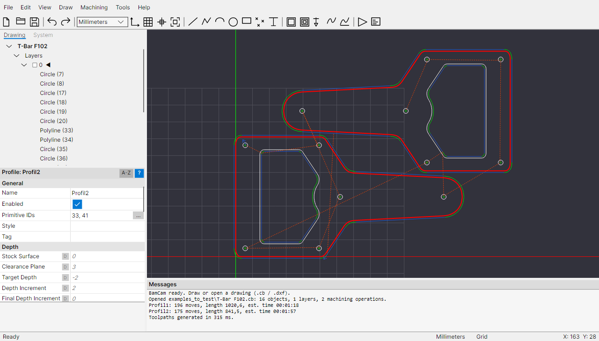
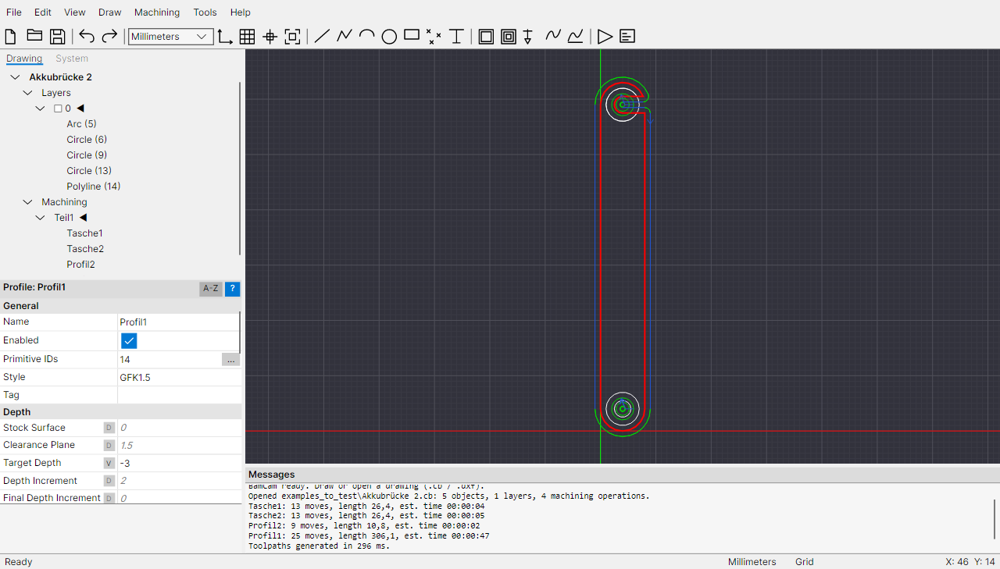
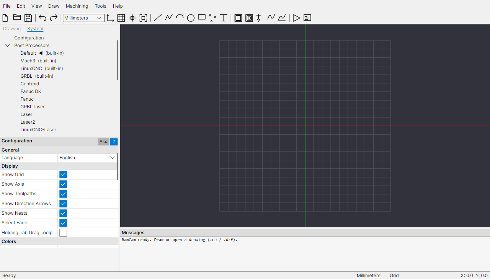

# BamCam

Cross-platform 2.5D CAD/CAM application (Windows, Linux, macOS) whose workflow and feature set follow
CamBam. Built with **Avalonia 11** on **.NET 10**.

BamCam reads and writes CamBam-compatible drawings (`.cb`) and post processors (`.cbpp`), imports DXF,
STL and G-code, and produces G-code through a template engine that understands the `{$macro}` language of
`.cbpp` files.



<table>
  <tr>
    <td width="33%"><a href="docs/screenshots/battery-bridge-toolpaths.png"></a></td>
    <td width="33%"><a href="docs/screenshots/polyline-points.png"></a></td>
    <td width="33%"><a href="docs/screenshots/configuration.png"></a></td>
  </tr>
  <tr>
    <td>Pockets and profiles with toolpaths; machining operation properties with Primitive IDs</td>
    <td>Selected polyline: edit its points with <b>[...]</b></td>
    <td>Configuration with language selection and post processors</td>
  </tr>
</table>

## Build and run

Requirement: .NET SDK 10.

```bash
dotnet build
```

```bash
dotnet run --project src/BamCam.App
```

```bash
dotnet test
```

Self-contained builds (no .NET installation needed) for any platform:

```bash
dotnet publish src/BamCam.App -c Release -r win-x64 --self-contained -o artifacts/win-x64
```

Other runtime IDs: `linux-x64`, `linux-arm64`, `osx-arm64`, `osx-x64`.
On macOS this produces a plain executable; use the packaging script below for an `.app` bundle.

## Packages and releases

The script `build/package.ps1` publishes BamCam for one platform and packages it. It runs with Windows
PowerShell 5.1 and PowerShell 7:

```bash
powershell -ExecutionPolicy Bypass -File build/package.ps1 -Rid win-x64 -Version 1.0.0
```

| Platform | Result in `artifacts/` |
|---|---|
| `win-x64` | `BamCam-<version>-win-x64.zip`, plus `-setup.exe` when Inno Setup 6 is installed |
| `linux-x64`, `linux-arm64` | `.tar.gz` with `install.sh` (per user, or `sudo ./install.sh --system`), `.desktop` entry and icon |
| `osx-x64`, `osx-arm64` | `.zip` with `BamCam.app`. Icon, executable permissions and the ad-hoc signature are only added when built on macOS |

Build the Linux and macOS packages on their own systems (the CI does this) so that executable permissions
are kept and the macOS bundle gets signed.

**First start on macOS:** the app has no Apple developer certificate, so macOS blocks it after downloading.
Either remove the download flag once in Terminal:

```bash
xattr -dr com.apple.quarantine /path/to/BamCam.app
```

or try to open it, then click "Open Anyway" in System Settings ▸ Privacy & Security.

**CI (GitHub Actions, `.github/workflows/build.yml`):**
- Every push and pull request builds and tests on Windows, Linux and macOS.
- Running the workflow manually ("Run workflow") also builds all packages; they can be downloaded from the run.
- A tag `v1.2.3` builds all packages and publishes a GitHub release:

```bash
git tag v1.2.3
```

```bash
git push origin v1.2.3
```

The app icon is generated by `build/make-icon.ps1` (Windows); the files are in `src/BamCam.App/Assets`.

## Project structure

| Project | Contents |
|---|---|
| `src/BamCam.Core` | Geometry (bulge polylines, arcs, matrices, offsets/booleans via Clipper2, arc fitting), document model, machining operations with Default/Value/Auto parameters, toolpath generators, post processor engine, CAD operations, translations |
| `src/BamCam.IO` | `.cb` reader/writer (lossless round trip, unknown elements are kept), `.cbpp`, style and tool libraries, DXF import (splines stay splines)/export, STL import |
| `src/BamCam.App` | Avalonia user interface: menu, toolbar, drawing/system tree, property grid, drawing view with snapping, drawing and transform tools, message window |
| `tests/BamCam.Tests` | Unit and integration tests |
| `docs/` | Specifications of the user interface and the file formats, screenshots |
| `examples_to_test/` | Example drawings with the DXF source and the G-code CamBam produced for them (used by the tests) |

## Features

**Drawing:** line, polyline, arc, circle, rectangle (with corner radius), point list, text (TrueType outlines),
spline (NURBS; drawn through clicked points with CamBam-style tangent handles, Ctrl unlinks a handle);
edit in the drawing by double-click (drag points) or as a point table in the properties; snap to grid and
object points; full right-click context menu on objects.

**CAD:** move, rotate, mirror, resize, array and polar array copy, center, join, offset, open offset,
explode, union/subtract/intersection, convert to polyline/region, reverse/clean polylines,
divide geometry/centers, cut/copy/paste (also between instances), undo/redo.

**CAM:**
- **Profile:** inside/outside, cut width with several passes, collision detection, corner overcut,
  holding tabs (automatic/manual, square/triangle), tangent and spiral lead-ins.
- **Pocket:** offset and hatch fills, islands.
- **Drill:** canned cycles G81/G82/G83 and spiral milling.
- **Engrave** and **NC file** (G-code back-plot).
- **3D profile** on triangle meshes (STL):
  - Scanline horizontal/vertical, as level roughing or finishing, with an exact drop cutter for end and ball mills.
  - Waterline roughing and finishing.
  - Boundary by outline, bounding box, selected shapes, clip area, margin and taper.
  - Back face and mold.
- **Lathe** (turning): draw only the profile on one side of the spindle axis, which runs through the machining
  origin (lathe Z along drawing X). Roughing in radial depth increments with 45° lead out, then a contour pass;
  finishing makes the contour pass only; right or left hand cutting. The output is the virtual tool tip, X as
  radius or diameter depending on the post processor. The G-code for CamBam's `lathe-test` sample (right and left
  hand, Mach3-Turn-CutViewer post) matches CamBam's output line for line.
- Machining operations refer to drawing objects by ID (**Primitive IDs**); edit the list as text or pick
  the objects in the drawing with **[...]**.
- Also: depth levels and cut ordering, CAM styles with inheritance, tool libraries, toolpath display with
  rapids and cut widths, toolpaths to geometry.

**G-code:** built-in post processors Default, Mach3, LinuxCNC and GRBL; existing `.cbpp` files are loaded
(own system folder `%APPDATA%/BamCam/post` or `~/.config/BamCam/post`, and a local CamBam installation).
The G-code produced for the CamBam sample `snap-together-box.cb` matches the reference in all 6382 motion
lines (depth levels, holding tabs, corner overcuts, arcs, nesting copies). For the example drawings in
`examples_to_test` it matches CamBam's output line for line or within 0.004 mm.

**Not implemented yet:** additive 3D mode, exact bull nose geometry (computed as ball nose),
bitmap objects, script objects, printing, speeds and feeds calculator. Such operations are kept
unchanged when `.cb` files are loaded and saved.

## Settings

Tools ▸ Options (or System ▸ Configuration) edits the application settings:
- Display and colors, grid for mm and inches, units and font for new drawings.
- Repeating draw commands, snapping.
- Default post processor, G-code file extension, overwrite prompt and external G-code editor.
- Number of backup files and length of the recent files list.
- Language.

They are stored in `settings.json` in the system folder (`%APPDATA%/BamCam` or `~/.config/BamCam`),
together with the window size, column widths and recent files. The environment variable `BAMCAM_SETTINGS`
selects a different file.

## Languages

The user interface is available in English and German. By default it follows the operating system language
(English when there is no translation); change it in Tools ▸ Options ▸ General ▸ Language, which takes effect
immediately.

English is the source language in the code. Every other language is a JSON file that maps the English text
to its translation, e.g. `"Generate Toolpaths": "Werkzeugwege erzeugen"`; `"_language"` holds the name of the
language in that language. Missing entries are shown in English.
- Built in: `src/BamCam.Core/Localization/lang/*.json` (e.g. `de.json`).
- Without rebuilding: put a `<code>.json` file (e.g. `fr.json`) into a `lang` folder next to the program or
  in the system folder. Single entries of a built-in language can be overridden there too.
- New language: copy `de.json`, translate `"_language"` and all values. An underscore in menu texts marks
  the access key (exactly one per text); keep placeholders such as `{0}` or `{0:0.###}`.
- The `LocalizationTests` collect every user interface text and report missing translations; the missing
  entries are written to `%TEMP%/bamcam-missing-<code>.json`.

Files (`.cb`, G-code, DXF) are language neutral.

## Controls (excerpt)

| Input | Action |
|---|---|
| Mouse wheel | Zoom at the cursor |
| Drag with middle button | Pan |
| Alt + drag with left button | Rotate the 3D view |
| Alt + double-click / Home | Reset the view |
| P, A, C, R, D, T | Polyline, arc, circle, rectangle, point list, text |
| Enter / middle click | Finish the object |
| Esc | Cancel |
| Right click on an object | Context menu (edit points, transform, machining, ...) |
| Ctrl+T / Ctrl+W | Generate toolpaths / produce G-code |
| Ctrl+M / Ctrl+R / Ctrl+E | Move / rotate / resize |
| Shift + arrow keys | Move the selection by one grid step |
| Space (in the tree) | Show/hide layer, enable/disable part or machining operation |

## License

BamCam is released under the [MIT License](LICENSE).

Third-party components keep their own licenses: Avalonia, SkiaSharp, HarfBuzzSharp and CommunityToolkit.Mvvm
(MIT), Clipper2 (Boost Software License 1.0) and the Inter font (SIL Open Font License 1.1).

## Legal notice

BamCam is an independent implementation. No CamBam program code was decompiled or analysed. It is based
solely on the user documentation and on observable behaviour, i.e. the files the program writes (black-box
analysis). The compatibility tests read the sample files of a locally installed, licensed copy of CamBam;
those files are not part of this repository, and without such an installation these tests check nothing
and pass. The example drawings in `examples_to_test` were contributed by the repository owner.
"CamBam" is a trademark of its owner.
