# BamCam

Cross-platform 2.5D CAD/CAM application (Windows, Linux, macOS) whose workflow and feature set follow
CamBam. Built with **Avalonia 11** on **.NET 10**.

BamCam reads and writes CamBam-compatible drawings (`.cb`) and post processors (`.cbpp`), imports DXF,
STL and G-code, and produces G-code through a template engine that understands the `{$macro}` language of
`.cbpp` files. Operations only BamCam has (such as Plasma or V-Engrave) are not shown by CamBam, and saving the
drawing there loses them.

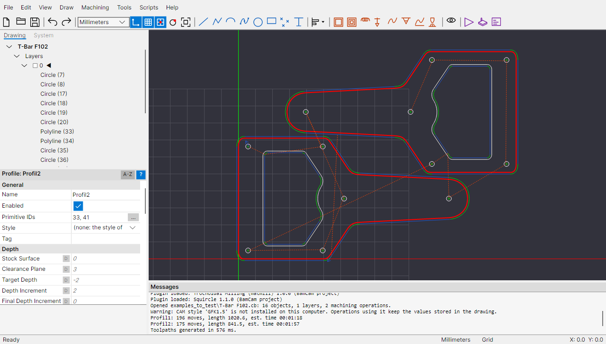

BamCam needs a system supported by .NET 10; on Windows that is Windows 10 version 1607 or later or Windows 11,
64 bit (not Windows 7 or 8).

<table>
  <tr>
    <td width="33%"><a href="docs/screenshots/battery-bridge-toolpaths.png">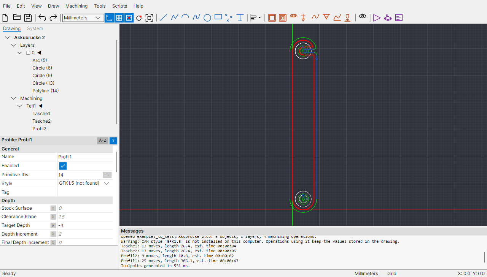</a></td>
    <td width="33%"><a href="docs/screenshots/polyline-points.png">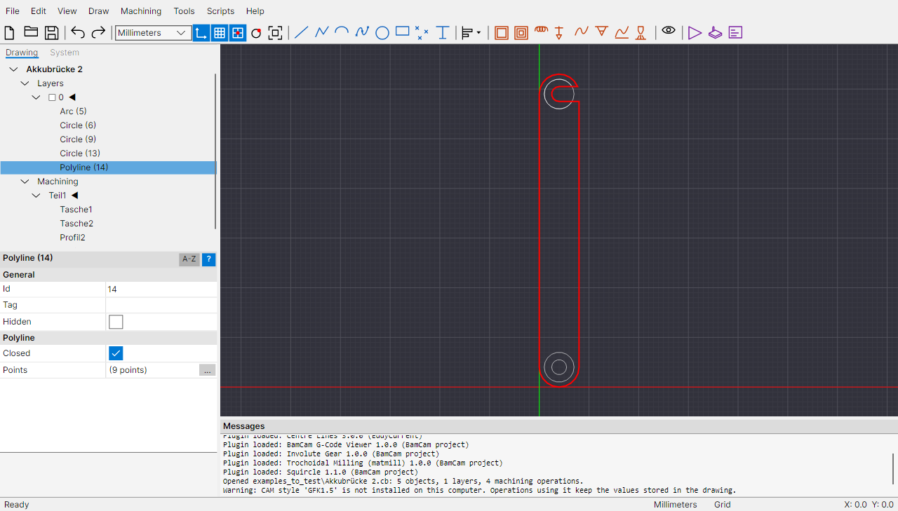</a></td>
    <td width="33%"><a href="docs/screenshots/configuration.png">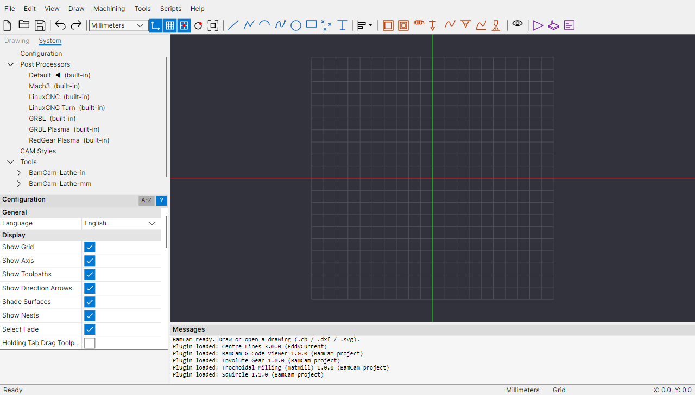</a></td>
  </tr>
  <tr>
    <td>Pockets and profiles with toolpaths; machining operation properties with Primitive IDs</td>
    <td>Selected polyline: edit its points with <b>[...]</b></td>
    <td>Configuration with language selection and post processors</td>
  </tr>
  <tr>
    <td><a href="docs/screenshots/lathe-shaft.png">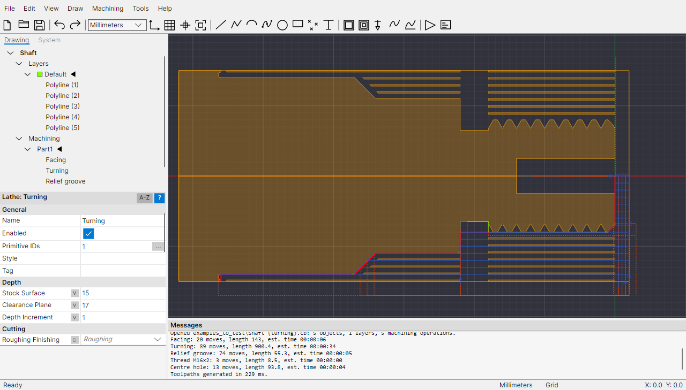</a></td>
    <td><a href="docs/screenshots/splines.png">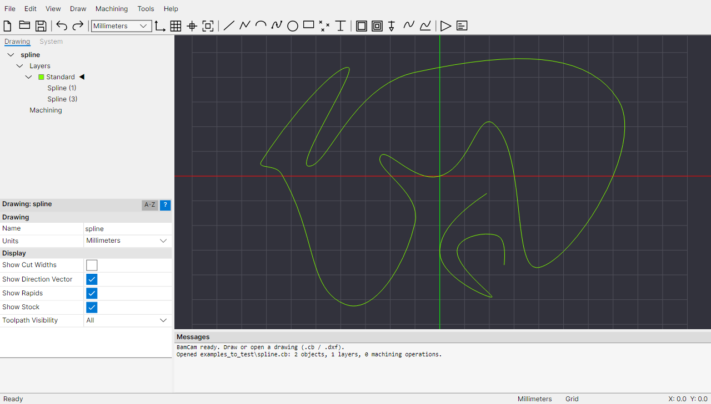</a></td>
    <td><a href="docs/screenshots/plugins.png">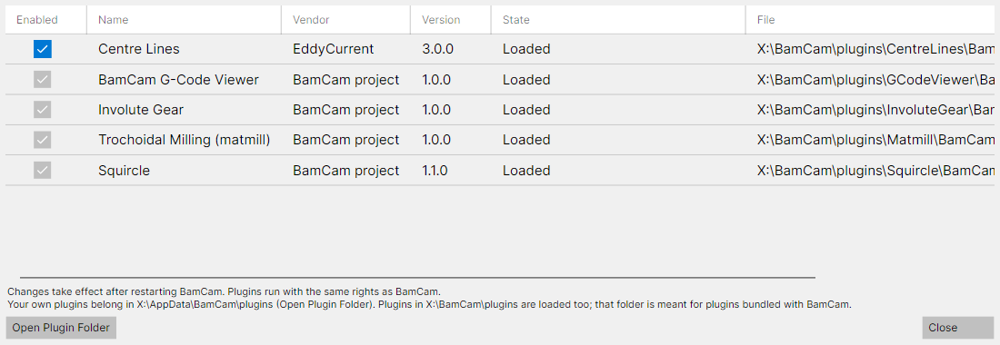</a><br><a href="docs/screenshots/speeds-feeds.png">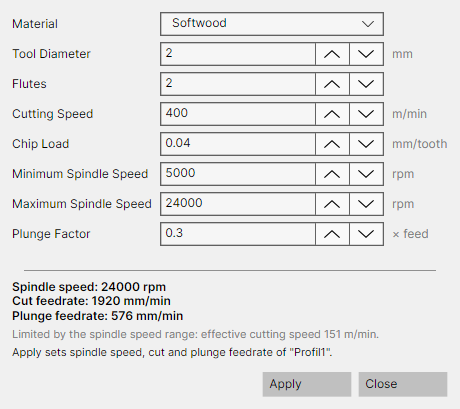</a></td>
  </tr>
  <tr>
    <td>Lathe: facing, turning, relief groove, M16 thread and centre hole; the remaining stock is shown
        (<code>examples_to_test/Shaft (turning).cb</code>)</td>
    <td>Splines (NURBS) drawn with CamBam-style tangent handles</td>
    <td>Plugin manager and speeds and feeds calculator</td>
  </tr>
  <tr>
    <td><a href="docs/screenshots/script-object.png">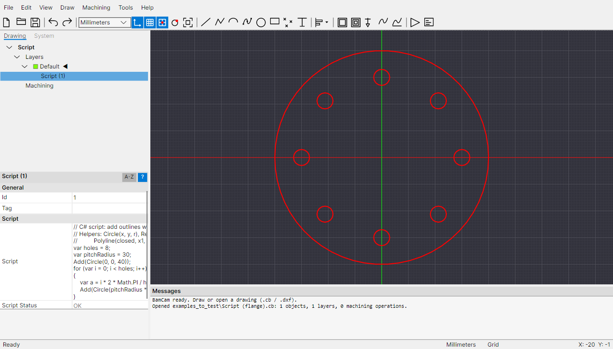</a><br><a href="docs/screenshots/script-editor.png">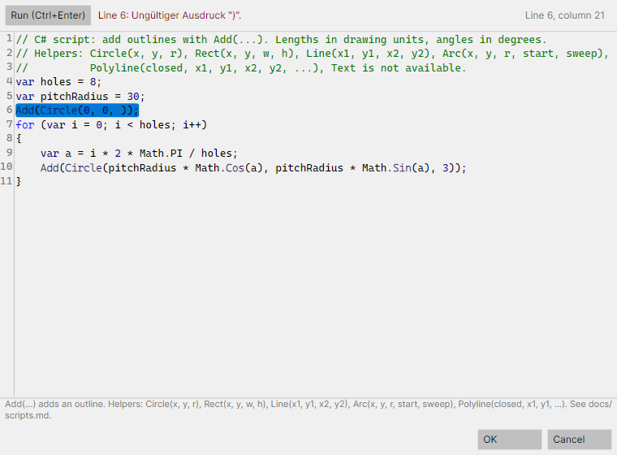</a></td>
    <td><a href="docs/screenshots/text-on-polyline.png">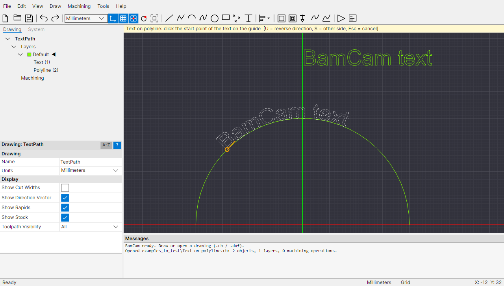</a></td>
    <td><a href="docs/screenshots/image-trace.png">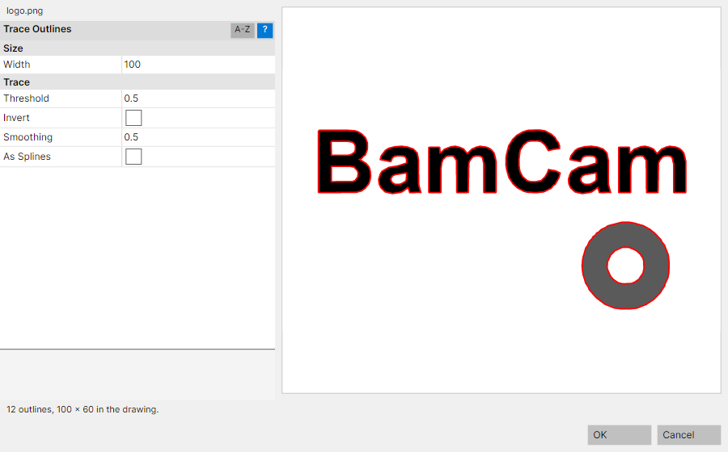</a></td>
  </tr>
  <tr>
    <td>C# script object (a flange with holes) and the script editor, which jumps to a compile error</td>
    <td>Text along a polyline: the preview follows the cursor on the guide</td>
    <td>Image import: traced outlines previewed while the threshold is set</td>
  </tr>
</table>

## Documentation

- [User guide](docs/user-guide.md): from the first start to G-code, all drawing and machining functions, shortcuts.
- [Scripts](docs/scripts.md), [script reference](docs/script-reference.md), [writing plugins](docs/plugins.md), [porting CamBam plugins](docs/porting-cambam-plugins.md).

## Build and run

Requirement: .NET SDK 10.

```bash
dotnet build
```

```bash
dotnet run --project src/BamCam.App
```

```bash
dotnet test
```

Self-contained builds (no .NET installation needed) for any platform:

```bash
dotnet publish src/BamCam.App -c Release -r win-x64 --self-contained -o artifacts/win-x64
```

Other runtime IDs: `linux-x64`, `linux-arm64`, `osx-arm64`, `osx-x64`.
On macOS this produces a plain executable; use the packaging script below for an `.app` bundle.

## Packages and releases

The script `build/package.ps1` publishes BamCam for one platform and packages it. It runs with Windows
PowerShell 5.1 and PowerShell 7:

```bash
powershell -ExecutionPolicy Bypass -File build/package.ps1 -Rid win-x64 -Version 1.0.0
```

| Platform | Result in `artifacts/` |
|---|---|
| `win-x64` | `BamCam-<version>-win-x64.zip`, plus `-setup.exe` when Inno Setup 6 is installed |
| `linux-x64`, `linux-arm64` | `.tar.gz` with `install.sh` (per user, or `sudo ./install.sh --system`), `.desktop` entry and icon |
| `osx-x64`, `osx-arm64` | `.zip` with `BamCam.app`. Icon, executable permissions and the ad-hoc signature are only added when built on macOS |

Build the Linux and macOS packages on their own systems (the CI does this) so that executable permissions
are kept and the macOS bundle gets signed.

**First start on macOS:** the app has no Apple developer certificate, so macOS blocks it after downloading.
Either remove the download flag once in Terminal:

```bash
xattr -dr com.apple.quarantine /path/to/BamCam.app
```

or try to open it, then click "Open Anyway" in System Settings ▸ Privacy & Security.

**CI (GitHub Actions, `.github/workflows/build.yml`):**
- Every push and pull request builds and tests on Windows, Linux and macOS.
- Running the workflow manually ("Run workflow") also builds all packages; they can be downloaded from the run.
- A tag `v1.2.3` builds all packages and publishes a GitHub release:

```bash
git tag v1.2.3
```

```bash
git push origin v1.2.3
```

The app icon is generated by `build/make-icon.ps1` (Windows); the files are in `src/BamCam.App/Assets`.

## Project structure

| Project | Contents |
|---|---|
| `src/BamCam.Core` | Geometry (bulge polylines, arcs, matrices, offsets/booleans via Clipper2, arc fitting), document model, machining operations with Default/Value/Auto parameters, toolpath generators, post processor engine, CAD operations, translations |
| `src/BamCam.IO` | `.cb` reader/writer (lossless round trip, unknown elements are kept), `.cbpp`, style and tool libraries, DXF import (splines stay splines)/export, STL import |
| `src/BamCam.App` | Avalonia user interface: menu, toolbar, drawing/system tree, property grid, drawing view with snapping, drawing and transform tools, message window |
| `src/BamCam.PluginApi` | Plugin interface (commands, machining operation types) |
| `samples/BamCam.SamplePlugin` | Example plugin: regular polygon command, facing operation |
| `tests/BamCam.Tests` | Unit and integration tests |
| `docs/` | Specifications of the user interface and the file formats, screenshots |
| `examples_to_test/` | Example drawings with the DXF source and the G-code CamBam produced for them (used by the tests) |

## Features

**Drawing:** line, polyline, arc, circle, rectangle (with corner radius), point list, text (TrueType outlines),
spline (NURBS; drawn through clicked points with CamBam-style tangent handles, Ctrl unlinks a handle);
edit in the drawing by double-click (drag points) or as a point table in the properties; snap to grid and
to objects (end points, mid points, circle centres, quadrants and intersections, each switchable in
View ▸ Object Snap Modes; toggle buttons in the toolbar); exact sizes by typing while drawing (segment length and
angle as `25<30`, circle diameter, rectangle width x height; Shift snaps the direction to 15° steps); full right-click context menu on objects.

**CAD:** move, rotate, mirror, resize, array and polar array copy, center, join, offset, open offset,
explode, union/subtract/intersection, convert to polyline/region, reverse/clean polylines,
fillet / chamfer / corner overcut at polyline corners, trim / extend lines and arcs against boundaries,
break objects at their intersections,
align objects (left, centre, right, top, middle, bottom) to the last or first selected object, the selection,
the drawing, the origin or the stock, text along a polyline (Draw ▸ Text on Polyline, start point clicked on the guide),
divide geometry/centers, cut/copy/paste (also between instances), undo/redo.

**CAM:**
- **Profile:** inside/outside (open shapes are cut beside the line: outside to the right of its point order, inside to
  the left), cut width with several passes, collision detection, corner overcut,
  holding tabs (automatic/manual, square/triangle), tangent and spiral lead-ins (spiral angle 0: one continuous
  helix, one lap per depth increment, with a flat lap only at the target depth).
- **Pocket:** offset and hatch fills, islands.
- **Trochoidal pocket and profile** (high speed clearing): a port of the CamBam plugin
  [matmill](https://github.com/jkmnt/matmill) by jkmnt (MIT License), shipped as a plugin; slices along the centre lines
  between a minimum and a maximum stepover, mixed milling direction, smooth chords, islands.
- **Drill:** canned cycles G81/G82/G83 and spiral milling.
- **Engrave** and **NC file** (G-code back-plot).
- **V-engrave** (V-carving) of text, regions and closed polylines: the V-bit follows the centre lines (medial axis)
  and goes as deep as the shape is wide, with sharp corners; areas wider than the cone at the target depth get a
  flat bottom (outline plus clearing passes); V angle, tip diameter and depth passes.
- **Drag knife** (vinyl / foil cutting): the path moves forward by the blade offset, with swivel arcs around
  corners above the swivel angle and an overcut at the end of closed shapes.
- **Plasma** (also laser / oxy-fuel): kerf compensation (outlines outside, holes inside), holes before the outline
  around them, arc or line lead-ins and lead-outs through the scrap, torch on / off per cut with pierce height,
  pierce delay and cut height, either fixed or measured by probing with the torch switch (G38.2), THC on / off and
  slower small holes; plasma cut data tables (material, thickness, current → kerf, feedrate, heights) linked to
  the operations.
- **3D profile** on triangle meshes (STL):
  - Scanline horizontal/vertical, as level roughing or finishing, with an exact drop cutter for end, ball and
    bull nose mills (bull nose when the operation has a corner radius).
  - Waterline roughing and finishing.
  - Boundary by outline, bounding box, selected shapes, clip area, margin and taper.
  - Back face and mold.
- **Lathe** (turning): draw only the profile on one side of the spindle axis, which runs through the machining
  origin (lathe Z along drawing X). Roughing in radial depth increments with 45° lead out, then a contour pass;
  finishing makes the contour pass only; right or left hand cutting. The output is the virtual tool tip, X as
  radius or diameter depending on the post processor. The G-code for CamBam's `lathe-test` sample (right and left
  hand, Mach3-Turn-CutViewer post) matches CamBam's output line for line.
  Further turning operations (BamCam's own, not in CamBam): **facing**, **grooving / parting off** (pecking,
  finish pass), **threading** (external/internal, metric depth by default; G76 cycle when the post defines one,
  e.g. the built-in *LinuxCNC Turn* post, otherwise single G33 passes) and **axial drilling** with pecks.
  The stock that remains after the turning operations is shown in the drawing (simulation).
  **Internal turning** (boring): the lathe operation can cut a bore wall instead of the outside, starting from the
  pre-drilled hole (Stock Surface = its radius) and retracting towards the axis
  (example: `examples_to_test/Bushing (boring).cb`).
  **Constant cutting speed** (G96) for turning, facing and grooving with a spindle speed limit; the codes come
  from the post processor (G50 + G96 + G97 by default, `G96 D… S…` in the *LinuxCNC Turn* post).
  **Nose radius compensation** either computed (virtual tool tip, as CamBam) or by the machine: the contour pass
  is then output on the part contour between G42/G41 and G40.
  **Lathe tool library** `BamCam-Lathe-mm` / `-in` (created in the system folder `tools`): turning, grooving,
  parting, threading and drilling tools with tool type and tip orientation. Turning operations find their tool
  number there, and warn when the tool type does not fit. Tools of BamCam's own libraries can be edited, added
  (right-click on the library) and deleted in the System tab.
- Machining operations refer to drawing objects by ID (**Primitive IDs**); edit the list as text or pick
  the objects in the drawing with **[...]**.
- **Speeds and feeds** (Tools menu): spindle speed, cut and plunge feedrate from material, tool diameter and
  flutes, limited to the spindle speed range; **Apply** writes them into the selected machining operation.
  Own materials can be added in `cutting-materials.json` in the system folder
  (`[{"Name": "...", "CuttingSpeed": 300, "ChipLoadFactor": 0.01}]`, cutting speed in m/min, chip load = factor × diameter).
- **Images** (File ▸ Import Image): PNG, JPEG, BMP, GIF or WebP as a **height map** (brightness becomes a surface
  for the 3D profile, e.g. for reliefs) or **traced outlines** (closed polylines or splines of the dark or light areas).
- Also: depth levels and cut ordering, CAM styles with inheritance, tool libraries, toolpath display with
  rapids and cut widths, toolpaths to geometry.
- **3D simulation** of the milling operations: the stock as a height field cut with the real tool shape (end, ball,
  bull nose, V-bit), shaded and rotatable, with the rest material above each operation's target in colour and a
  slider to step through the moves.

**G-code:** built-in post processors Default, Mach3, LinuxCNC, LinuxCNC Turn, GRBL, GRBL Plasma and RedGear Plasma; existing `.cbpp` files are loaded
(own system folder `%APPDATA%/BamCam/post` or `~/.config/BamCam/post`, and a local CamBam installation).
**DXF export** as R2000 (splines stay splines) or R12, selectable in the options.
**Post-build command** of a post processor (as in CamBam): an external program run on the written G-code file,
arguments with `{$outfile}` and `{$cbfile.name}`; started without a shell, after the user allowed the command once,
with exit code and output in the message window.
The G-code produced for the CamBam sample `snap-together-box.cb` matches the reference in all 6382 motion
lines (depth levels, holding tabs, corner overcuts, arcs, nesting copies). For the example drawings in
`examples_to_test` it matches CamBam's output line for line or within 0.004 mm.

**Printing:** File ▸ Print writes a vector PDF (fit to page, true size 1:1 split over several pages, or a custom
scale; paper size, orientation, toolpaths, layer colours, caption) and opens it in the PDF viewer; File ▸ Export ▸
PDF saves it.

**Script objects** (Draw ▸ Script Object): drawing objects whose outlines come from a C# script stored in the
drawing (Edit ▸ Edit Script; helpers `Circle`, `Rect`, `Line`, `Arc`, `Polyline`, `Add`). A script from another
drawing runs only after the user allowed it; until then the outlines saved with the drawing are shown. CamBam's
Python scripts do not run.

**Scripts menu:** C# scripts as `.csx` files in the script folder, run from the menu, with access to the whole drawing
and one undo step per run. The editor has New, Save, Check (lists all compile errors without running) and Run. A
file runs only after the user saw its text and allowed it. See [docs/scripts.md](docs/scripts.md).

**Not implemented yet:** additive 3D mode, CamBam bitmap objects (images are imported as surfaces or outlines
instead). Such objects are kept unchanged when `.cb` files are loaded and saved.

## Plugins

BamCam can be extended with plugins from other vendors: .NET libraries that add menu commands, interactive
drawing tools, machining operation types (with their own parameters and toolpath generator), file formats and
post processor macros. The interface is available as NuGet packages attached to each release. They are installed in the `plugins` folder
of the system folder; BamCam asks once before loading a new plugin, and **Tools ▸ Plugins** switches them on
or off. See [docs/plugins.md](docs/plugins.md) for writing a plugin and
[samples/BamCam.SamplePlugin](samples/BamCam.SamplePlugin) for a complete example.

**Porting CamBam plugins:** CamBam plugins do not run unchanged, but their logic can be kept; the
[porting guide](docs/porting-cambam-plugins.md) maps CamBam's plugin concepts to BamCam's and explains how
drawings saved with a CamBam plugin operation keep opening with the port.

## Updates

At the first start BamCam asks whether it may check for new versions. If allowed, it asks GitHub at most once a
day (in the background, at start) for the list of releases and mentions a newer one in the message window and in
the Help menu, with its release notes and a link to the download page. Only the version list is requested; nothing
about you or your drawings is sent. **Help ▸ Check for Updates** checks at once; Tools ▸ Options switches the daily
check and test versions on or off. BamCam does not download or install anything by itself.

## Settings
Tools ▸ Options (or System ▸ Configuration) edits the application settings:
- Display and colors, grid for mm and inches, units and font for new drawings.
- Repeating draw commands, snapping.
- Default post processor, G-code file extension, overwrite prompt and external G-code editor.
- Number of backup files and length of the recent files list.
- Language.

They are stored in `settings.json` in the system folder (`%APPDATA%/BamCam` or `~/.config/BamCam`),
together with the window size, column widths and recent files. The environment variable `BAMCAM_SETTINGS`
selects a different file.

## Languages

The user interface is available in English and German. By default it follows the operating system language
(English when there is no translation); change it in Tools ▸ Options ▸ General ▸ Language, which takes effect
immediately.

English is the source language in the code. Every other language is a JSON file that maps the English text
to its translation, e.g. `"Generate Toolpaths": "Werkzeugwege erzeugen"`; `"_language"` holds the name of the
language in that language. Missing entries are shown in English.
- Built in: `src/BamCam.Core/Localization/lang/*.json` (e.g. `de.json`).
- Without rebuilding: put a `<code>.json` file (e.g. `fr.json`) into a `lang` folder next to the program or
  in the system folder. Single entries of a built-in language can be overridden there too.
- Tools ▸ Edit Language File lists every text with its built-in translation and an own text, with a search field;
  the own texts are saved to the system folder (`lang/<code>.json`) and apply at once. After editing such a file
  with another program, Tools ▸ Reload Language File applies it without a restart.
- New language: copy `de.json`, translate `"_language"` and all values. An underscore in menu texts marks
  the access key (exactly one per text); keep placeholders such as `{0}` or `{0:0.###}`.
- The `LocalizationTests` collect every user interface text and report missing translations; the missing
  entries are written to `%TEMP%/bamcam-missing-<code>.json`.

Files (`.cb`, G-code, DXF) are language neutral.

## Controls (excerpt)

| Input | Action |
|---|---|
| Mouse wheel | Zoom at the cursor |
| Drag with middle button | Pan |
| Alt + drag with left button | Rotate the 3D view |
| Alt + double-click / Home | Reset the view |
| P, A, C, R, D, T | Polyline, arc, circle, rectangle, point list, text |
| Enter / middle click | Finish the object |
| Esc | Cancel |
| Right click on an object | Context menu (edit points, transform, machining, ...) |
| Ctrl+T / Ctrl+W | Generate toolpaths / produce G-code |
| Ctrl+M / Ctrl+R / Ctrl+E | Move / rotate / resize |
| Shift + arrow keys | Move the selection by one grid step |
| Space (in the tree) | Show/hide layer, enable/disable part or machining operation |

## Contributing

Bug reports, ideas, translations and pull requests are welcome: see [CONTRIBUTING.md](CONTRIBUTING.md).

## License

BamCam is released under the [MIT License](LICENSE).

Third-party components keep their own licenses: Avalonia, AvaloniaEdit, SkiaSharp, HarfBuzzSharp, CommunityToolkit.Mvvm,
Roslyn scripting and Delaunator (DelaunatorSharp)
(MIT), Clipper2 (Boost Software License 1.0) and the Inter font (SIL Open Font License 1.1).

## Legal notice

BamCam is an independent implementation. No CamBam program code was decompiled or analysed. It is based
solely on the user documentation and on observable behaviour, i.e. the files the program writes (black-box
analysis). The compatibility tests read the sample files of a locally installed, licensed copy of CamBam;
those files are not part of this repository, and without such an installation these tests check nothing
and pass. The example drawings in `examples_to_test` were contributed by the repository owner.
"CamBam" is a trademark of its owner.
