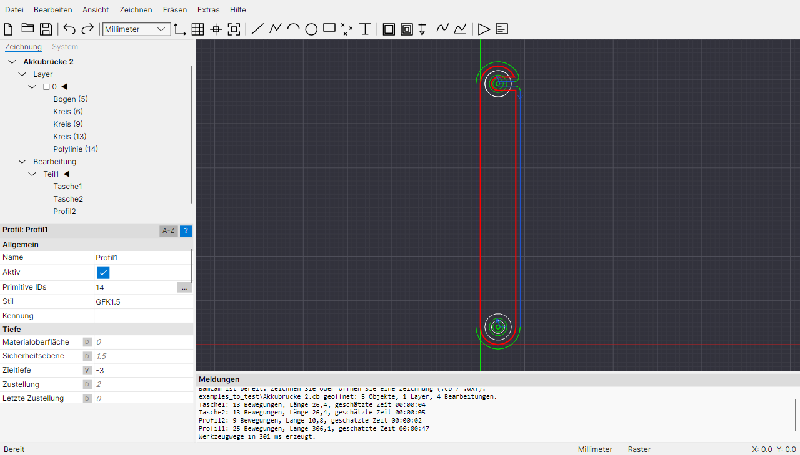
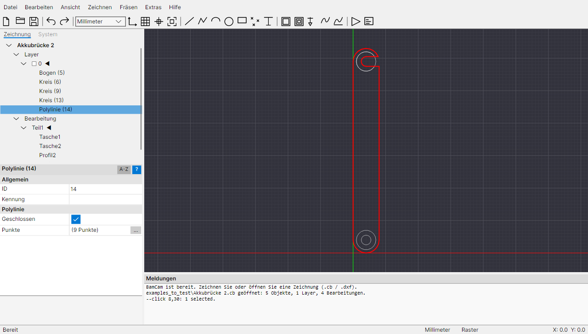
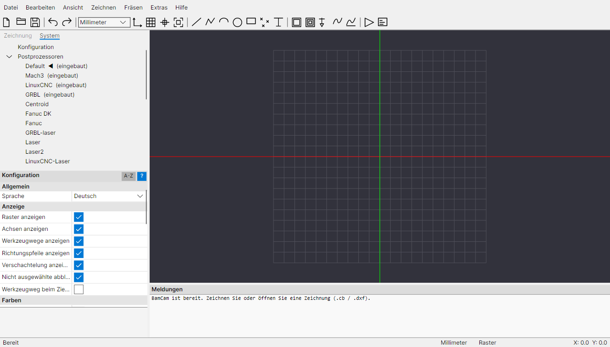

# BamCam

Plattformübergreifende 2.5D-CAD/CAM-Anwendung (Windows, Linux, macOS) mit Bedienkonzept und
Funktionsumfang nach dem Vorbild von CamBam. Gebaut mit **Avalonia 11** auf **.NET 10**.

BamCam liest und schreibt CamBam-kompatible Zeichnungen (`.cb`) und Postprozessoren (`.cbpp`),
importiert DXF, STL und G-Code und erzeugt G-Code über eine Template-Engine mit der
`{$makro}`-Sprache der `.cbpp`-Dateien.


<table>
  <tr>
    <td width="33%"><a href="docs/screenshots/akkubruecke-werkzeugwege.png"></a></td>
    <td width="33%"><a href="docs/screenshots/polylinie-punkte.png"></a></td>
    <td width="33%"><a href="docs/screenshots/konfiguration.png"></a></td>
  </tr>
  <tr>
    <td>Akkubrücke: Taschen und Profile mit Werkzeugwegen, Eigenschaften der Bearbeitung mit Primitive IDs</td>
    <td>Ausgewählte Polylinie: Punkte über <b>[...]</b> bearbeiten</td>
    <td>Konfiguration mit Sprachauswahl und Postprozessoren</td>
  </tr>
</table>

## Bauen und starten

Voraussetzung: .NET SDK 10.

```bash
dotnet build
```

```bash
dotnet run --project src/BamCam.App
```

```bash
dotnet test
```

Eigenständige Pakete (ohne installiertes .NET) für alle Plattformen:

```bash
dotnet publish src/BamCam.App -c Release -r win-x64 --self-contained -o artifacts/win-x64
```

Weitere Runtime-IDs: `linux-x64`, `linux-arm64`, `osx-arm64`, `osx-x64`.
Unter macOS ist das Ergebnis ein ausführbares Programm, noch kein signiertes `.app`-Bundle.

## Pakete und Releases

Das Skript `build/package.ps1` veröffentlicht BamCam für eine Plattform und verpackt es passend. Es läuft mit
Windows PowerShell 5.1 und PowerShell 7:

```bash
powershell -ExecutionPolicy Bypass -File build/package.ps1 -Rid win-x64 -Version 1.0.0
```

| Plattform | Ergebnis in `artifacts/` |
|---|---|
| `win-x64` | `BamCam-<Version>-win-x64.zip`, dazu `-setup.exe`, wenn Inno Setup 6 installiert ist |
| `linux-x64`, `linux-arm64` | `.tar.gz` mit `install.sh` (pro Benutzer, oder `sudo ./install.sh --system`), `.desktop`-Eintrag und Icon |
| `osx-x64`, `osx-arm64` | `.zip` mit `BamCam.app`, unsigniert. Icon und Ausführungsrechte entstehen nur beim Bauen auf macOS |

Linux- und macOS-Pakete sollten auf dem jeweiligen System gebaut werden (das erledigt die CI), damit die
Ausführungsrechte erhalten bleiben. Unsignierte macOS-Apps öffnet man beim ersten Start per Rechtsklick ▸ Öffnen.

**CI (GitHub Actions, `.github/workflows/build.yml`):**
- Jeder Push und Pull Request baut und testet auf Windows, Linux und macOS.
- Ein Tag `v1.2.3` erzeugt zusätzlich alle Pakete und ein GitHub-Release:

```bash
git tag v1.2.3
```

```bash
git push origin v1.2.3
```

Das App-Icon erzeugt `build/make-icon.ps1` (Windows). Die erzeugten Dateien liegen in `src/BamCam.App/Assets`.
## Projektstruktur

| Projekt | Inhalt |
|---|---|
| `src/BamCam.Core` | Geometrie (Bulge-Polylinien, Bögen, Matrizen, Offsets/Boolesche Operationen via Clipper2, Arc-Fitting), Dokumentmodell, CAM-Operationen mit Default/Value/Auto-Parametern, Werkzeugweg-Generatoren, Postprozessor-Engine, CAD-Operationen |
| `src/BamCam.IO` | `.cb`-Reader/Writer (verlustfreier Round-Trip, unbekannte Elemente bleiben erhalten), `.cbpp`, Stil- und Werkzeugbibliotheken, DXF-Import/-Export, STL-Import |
| `src/BamCam.App` | Avalonia-Oberfläche: Menü, Werkzeugleiste, Zeichnungs-/System-Baum, Eigenschaftsraster, Zeichenfläche mit Fang, Zeichen-/Transformationswerkzeugen, Meldungsfenster |
| `tests/BamCam.Tests` | Unit- und Integrationstests |
| `docs/` | Spezifikationen der Oberfläche und der Dateiformate |

## Funktionsstand

**Zeichnen:** Linie, Polylinie, Bogen, Kreis, Rechteck (mit Eckradius), Punktliste, Text (TrueType-Umrisse);
Bearbeiten per Doppelklick (Punkte ziehen); Fang an Raster und Objektpunkten.

**CAD:** Verschieben, Drehen, Spiegeln, Skalieren, Array- und Polar-Kopie, Zentrieren, Join, Offset,
Open Offset, Explode, Union/Subtract/Intersection, In Polylinie/Region umwandeln, Polylinie umkehren/bereinigen,
Punkte teilen/Zentren, Ausschneiden/Kopieren/Einfügen (auch zwischen Instanzen), Undo/Redo.

**CAM:**
- **Profil:** innen/außen, Schnittbreite mit mehreren Bahnen, Kollisionserkennung, Ecken-Freischnitt,
  Haltestege (automatisch/manuell, rechteckig/dreieckig), Tangential- und Spiral-Anfahrt.
- **Tasche:** Offset- und Schraffur-Füllung, Inseln.
- **Bohren:** Bohrzyklen G81/G82/G83 und Spiralfräsen.
- **Gravieren** und **NC-Datei** (G-Code-Rückplot).
- **3D-Profil** auf Dreiecksnetzen (STL):
  - Scanline horizontal/vertikal, als Schruppen in Ebenen oder als Schlichten, mit exaktem Drop-Cutter für Schaft- und Kugelfräser.
  - Waterline-Schruppen und -Schlichten.
  - Begrenzung über Umriss, Bounding Box, ausgewählte Objekte, Clip-Bereich, Rand und Konizität.
  - Rückseite und Form (Mold).
- Weiteres: Tiefenebenen und Schnittreihenfolge, CAM-Stile mit Vererbung, Werkzeugbibliotheken,
  Werkzeugweg-Anzeige mit Eilgängen und Schnittbreiten, Werkzeugwege in Geometrie umwandeln.

**G-Code:** Postprozessoren Default, Mach3, LinuxCNC, GRBL eingebaut; vorhandene `.cbpp`-Dateien werden geladen
(eigener Systemordner `%APPDATA%/BamCam/post`, bzw. `~/.config/BamCam/post`, sowie eine lokale CamBam-Installation).
Der für das CamBam-Beispiel `snap-together-box.cb` erzeugte G-Code stimmt in allen 6382 Bewegungszeilen mit der
mitgelieferten Referenz überein (Tiefenstufen, Haltestege, Freischnitte, Bögen, Verschachtelungs-Kopien).

**Noch nicht umgesetzt:** Additiver 3D-Modus, exakte Radiusfräser-Geometrie (wird als Kugelfräser gerechnet), Drehen (Lathe), Spline- und Bitmap-Objekte, Skript-Objekte,
Druck,
Schnittgeschwindigkeits-Rechner. Diese Operationen bleiben beim Laden und Speichern von `.cb`-Dateien unverändert erhalten.

## Einstellungen

Tools ▸ Options (oder System ▸ Configuration) bearbeitet die Programmeinstellungen:
- Anzeige und Farben, Raster für mm und Zoll, Einheiten und Schrift für neue Zeichnungen.
- Wiederholen von Zeichenbefehlen, Fangen.
- Standard-Postprozessor, G-Code-Endung, Nachfrage beim Überschreiben und externer G-Code-Editor.
- Anzahl der Sicherungsdateien und Länge der Liste „Zuletzt geöffnet“.

Gespeichert wird in `settings.json` im Systemordner (`%APPDATA%/BamCam` bzw. `~/.config/BamCam`), zusammen mit
Fenstergröße, Spaltenbreiten und den zuletzt geöffneten Dateien. Mit der Umgebungsvariable `BAMCAM_SETTINGS`
kann eine andere Datei verwendet werden.

## Sprachen

Die Oberfläche gibt es auf Englisch und Deutsch. Voreingestellt ist die Sprache des Betriebssystems (sonst Englisch);
umstellen lässt sie sich unter Tools ▸ Options ▸ Allgemein ▸ Sprache, die Änderung wirkt sofort.

Englisch ist die Ausgangssprache im Code. Jede weitere Sprache ist eine JSON-Datei, die den englischen Text auf
die Übersetzung abbildet, z. B. `"Generate Toolpaths": "Werkzeugwege erzeugen"`; `"_language"` enthält den Namen der
Sprache in der Sprache selbst. Fehlende Einträge erscheinen auf Englisch.
- Eingebaut: `src/BamCam.Core/Localization/lang/*.json` (z. B. `de.json`).
- Ohne neuen Build: eine Datei `<code>.json` (z. B. `fr.json`) in den Ordner `lang` neben dem Programm oder im
  Systemordner legen. Einzelne Einträge einer eingebauten Sprache lassen sich dort ebenso überschreiben.
- Neue Sprache anlegen: `de.json` kopieren, `"_language"` und alle Werte übersetzen. Ein Unterstrich in Menütexten
  markiert die Zugriffstaste (genau einer pro Text), Platzhalter wie `{0}` oder `{0:0.###}` bleiben erhalten.
- Der Test `LocalizationTests` sammelt alle Texte der Oberfläche und meldet fehlende Übersetzungen; die Liste der
  fehlenden Einträge landet in `%TEMP%/bamcam-missing-<code>.json`.

Dateien (`.cb`, G-Code, DXF) sind sprachunabhängig.

## Bedienung (Auszug)

| Eingabe | Wirkung |
|---|---|
| Mausrad | Zoom am Cursor |
| Mittlere Taste ziehen | Verschieben |
| Alt + linke Taste ziehen | 3D-Ansicht drehen |
| Alt + Doppelklick / Pos1 | Ansicht zurücksetzen |
| P, A, C, R, D, T | Polylinie, Bogen, Kreis, Rechteck, Punktliste, Text |
| Enter / mittlerer Klick | Objekt abschließen |
| Esc | Abbrechen |
| Strg+T / Strg+W | Werkzeugwege erzeugen / G-Code erzeugen |
| Strg+M / Strg+R / Strg+E | Verschieben / Drehen / Skalieren |
| Umschalt + Pfeiltasten | Auswahl um ein Rasterfeld verschieben |
| Leertaste (im Baum) | Layer ein-/ausblenden, Part/MOP aktivieren/deaktivieren |

## Rechtlicher Hinweis

BamCam ist eine eigenständige Neuentwicklung. Programmcode von CamBam wurde weder decompiliert noch
analysiert. Grundlage waren ausschließlich die Benutzerdokumentation sowie das beobachtbare Verhalten,
also die Dateien, die das Programm schreibt (Black-Box-Analyse). Die Kompatibilitätstests lesen die
Beispieldateien einer lokal installierten, lizenzierten CamBam-Version; diese Dateien sind nicht
Bestandteil dieses Repositorys. Ohne eine solche Installation prüfen diese Tests nichts und gelten als bestanden.
„CamBam“ ist eine Marke ihres Inhabers.
